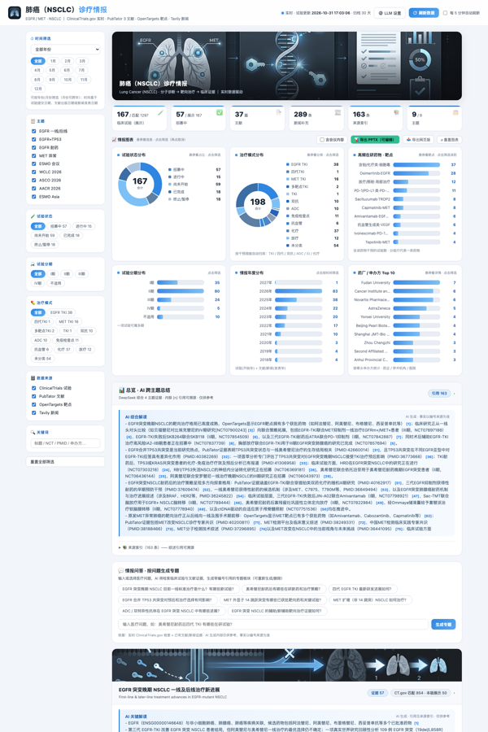
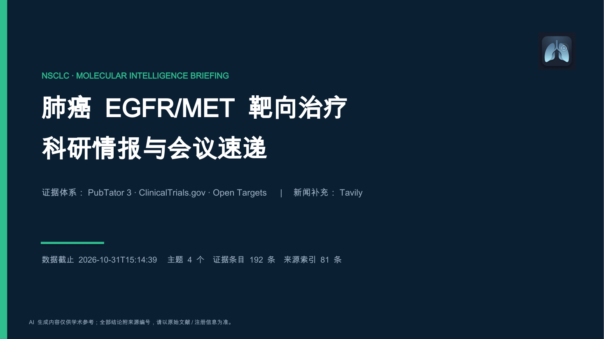
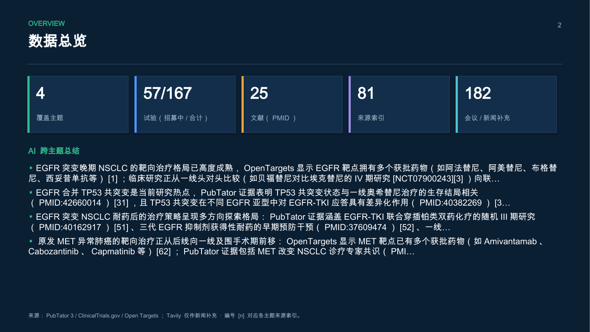
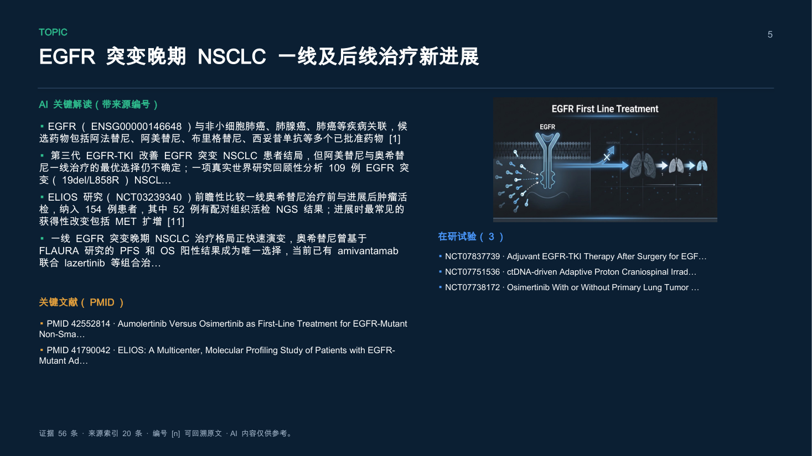

# 肺癌分子诊疗情报看板 · NSCLC Intelligence Dashboard


> 每日自动构建的肺癌（EGFR/MET 异常 NSCLC）科研情报看板：把**注册试验、文献、靶点药物、会议数据**汇成一份可溯源、可筛选、可导出 PPT 的中文情报端。

**English**: A self-hosted, daily-rebuilt intelligence dashboard for EGFR/MET-altered NSCLC. It aggregates ClinicalTrials.gov, PubTator 3, Open Targets and conference coverage into one evidence-traced dataset — every claim carries a numbered citation — and ships with an interactive web UI plus one-click export to an editable PowerPoint deck.

> **许可**：本项目采用 [CC BY-NC 4.0](LICENSE) —— **仅限非商业用途**；任何使用、改编、演示或论文引用**必须署名并标注出处**，且须保留作者邮箱 `loujiacheng1986@foxmail.com`（详见 [NOTICE.md](NOTICE.md)）。商业使用请另行联系作者授权。

**核心原则：所有结论必须可溯源。** AI 生成的每一句话都强制内联编号引用 `[n]`，编号指向页面内的来源索引（PMID / NCT / 靶点页面 / 新闻原文）；越界编号在构建时自动剔除。



---

## 目录

- [功能](#功能)
- [快速开始](#快速开始)
- [配置](#配置)
- [导出 PowerPoint](#导出-powerpoint)
- [定时每日构建](#定时每日构建)
- [数据来源与许可](#数据来源与许可)
- [架构](#架构)
- [已知限制](#已知限制)
- [免责声明](#免责声明)
- [License](#license)

---

## 功能

**情报采集（分层，来源权重明确）**

| 层 | 来源 | 用途 |
|---|---|---|
| 证据层 | ClinicalTrials.gov API v2 | 注册试验（状态、分期、入组、申办方、地点） |
| 证据层 | PubTator 3 | 文献与实体标注（基因/疾病/药物/突变/PMID） |
| 证据层 | Open Targets | 靶点–疾病关联、获批与在研药物、最高临床阶段 |
| 补充层 | Tavily | 会议报道与行业新闻（**仅作背景，不计入证据强度**） |

**看板（交互）**

- 时间（年/月）、主题、试验状态、分期、治疗模式、来源类型、关键词多维筛选，图表与列表联动
- 试验状态/分期/年度/来源构成/高频药物–靶点/药厂申办方 Top10 等图表
- 情报问答：按问题生成带编号引用的专题卡（可存可删）
- 会议库：按会议月份锚定的时间筛选，历史会议自动沉淀、不重复抓取

**导出（PPTX）**

- 一键生成**真正可编辑**的 PowerPoint：原生图表（可右键改数据）、原生表格、16:9 统一版式
- 导出内容与看板当前筛选**所见即所得**（命中哪些试验/文献/新闻就导出哪些）
- 会议内容默认不导出，可勾选"含会议内容"开启

<table>
<tr>
<td></td>
<td></td>
</tr>
<tr>
<td></td>
</tr>
</table>

---

## 快速开始

**环境**：Python 3.10+；macOS / Linux 均可。

```bash
git clone https://github.com/ChrisLou-bioinfo/AImednews.git
cd AImednews
python3 -m pip install -r requirements.txt

cp .env.example .env
#  填入 TAVILY_API_KEY（新闻/会议补充层）
#  填入 DEEPSEEK_BASE_URL / DEEPSEEK_MODEL / DEEPSEEK_API_KEY（AI 解读与抽取）
```

**① 构建一次数据**（首次约数分钟，取决于 API 配额与网络）

```bash
python3 news/build_dashboard.py --days 7
#  可选参数：--synth 生成 AI 总结；--no-news / --no-lit 跳过采集；--jobs N 并发主题数
#  产物：output/dashboards/<YYYYMMDD>/{index.html,data.json}
```

**② 启动看板**

```bash
python3 webapp/server.py --port 8899
#  浏览器打开 http://127.0.0.1:8899
```

服务端只依赖 Python 标准库 + `python-pptx`，不需要 Node、不需要数据库。看板读的是本地归档（`output/dashboards/`），实时试验层由服务端按需向 ClinicalTrials.gov 拉取并缓存。

---

## 配置

所有可配置内容集中在 `news/config.py`：

### 情报主题（`TOPICS`）

```python
{
    "id": "egfr_l1_later",                    # 主题 ID（同时是归档键）
    "title": "EGFR 突变晚期 NSCLC 一线及后线治疗新进展",
    "genes": ["EGFR"],                        # 靶点（Open Targets 采集）
    "ct_cond": "Non-Small Cell Lung Cancer",  # ClinicalTrials.gov query.cond
    "ct_term": "EGFR",                        # ClinicalTrials.gov query.term
    "pt_query": "...",                        # PubTator 文献检索式
    "news_queries": ["..."],                  # Tavily 检索式（补充层）
}
```

### 年度会议库（`CONFERENCES`）

按"每年每个大会一条"登记，构建时自动生成会议卡（关键试验结果表 + 会议报道汇总）：

```python
{
    "id": "conf_asco_2026",
    "title": "ASCO 2026 会议速递",
    "anchor_ym": "2026-06",          # 会议归属年月：时间筛选按此整卡纳入/排除
    "news_queries": ["ASCO 2026 关键试验 结果"],
    "extract_key_trials": True,      # 从报道正文抽取结构化结果（HR/95%CI/样本量）
    "refresh_after_days": 200,       # 超过该天数直接复用归档，不再联网抓取
}
```

新增会议只需追加一条配置——筛选、导出、归档、看板渲染全部自动生效。

---

## 导出 PowerPoint

看板右上角「📊 导出 PPTX（可编辑）」：

- 导出内容 = 你当前筛选命中的内容（试验 NCT / 文献 PMID / 新闻 URL 精确对齐）
- 生成物为 16:9 真实 `.pptx`：原生图表 4 个、原生表格（会议关键试验）若干页，可在 PowerPoint / Keynote / WPS 中直接编辑
- 服务端实现见 `webapp/ppt_deck.py`；接口 `POST /api/pptx`（GET `/api/pptx` 为无筛选全量）

> 中文字体说明：`.pptx` 使用 `Arial Unicode MS`（跨平台中英混排不丢字）。若目标机器缺少该字体，PowerPoint 会回退到系统中文字体，内容不受影响。

---

## 定时每日构建

```bash
# Linux / 任意 cron
0 8 * * * /path/to/AImednews/news/run_daily.sh

# macOS launchd
sed "s#__ROOT__#$PWD#g" deploy/com.aimednews.dashboard.plist.example \
  > ~/Library/LaunchAgents/com.aimednews.dashboard.plist
launchctl load ~/Library/LaunchAgents/com.aimednews.dashboard.plist
```

`news/run_daily.sh` 支持环境变量：`PYTHON`（解释器）、`BUILD_ARGS`（构建参数）、`KEEP_DAYS`（归档保留天数，默认 30）、`BUILD_TIMEOUT`（单轮看门狗，默认 2400 秒）。

---

## 数据来源与许可

本仓库**代码**为 MIT，但**数据**来自各自平台，使用时请遵守其条款并引用原始来源：

| 来源 | 许可 / 条款 | 引用 |
|---|---|---|
| ClinicalTrials.gov | U.S. 政府公共数据 | — |
| PubTator 3 / PubMed | NCBI 公共数据 | Wei et al., *NAR* 2024 |
| Open Targets | CC BY 4.0 | Ochoa et al., *NAR* 2023 |
| Tavily | 商业检索服务（需自备 API Key） | — |
| MedEvidence（可选） | 本项目可选依赖，用于封装上述采集 | — |

> 本仓库不含任何上游数据库的批量数据副本；`output/` 下只是采集结果的本地缓存（默认不入库）。

---

## 架构

```
news/                       采集与构建（Python）
  ├── config.py             主题 / 会议库 / 仪表盘配置
  ├── build_dashboard.py    采集 → 结构化 → AI 解读 → 校验引用 → 静态看板 + data.json
  └── run_daily.sh          定时构建与归档轮转
webapp/                     交互看板（Python 标准库 HTTP + vanilla JS）
  ├── server.py             /api/data、/api/ask、/api/report、/api/pptx 等
  ├── index.html            前端（筛选、图表、问答、导出）
  └── ppt_deck.py           PPTX 生成（原生图表/表格/引用溯源）
deploy/                     launchd 定时任务模板
docs/                       截图与设计说明
output/                     构建产物（不入库）
```

采集 → 证据编号（`SourceBook`）→ AI 解读强制引用 → 引用校验（越界编号剔除）→ 归档 `data.json` → 看板/PPT 双出口。

更细的设计说明见 [docs/ARCHITECTURE.md](docs/ARCHITECTURE.md)。

---

## 已知限制

- **AI 抽取有误差**：会议关键试验表由模型从公开报道抽取，表中已标注"数字请以原文为准"，每行可回溯来源；重要结论请核对原始摘要。
- **会议覆盖不均**：注册试验结果密集的大会（ASCO/ESMO/WCLC）覆盖较好；以早期机制研究为主的大会（如 AACR）可抽取到的"疗效+HR"条目较少。
- **依赖第三方配额**：Tavily 免费额度有限（advanced 检索约 2 credits/次）；无 Key 时新闻层自动跳过，其余照常。
- **非实时**：数据按日构建；看板里的"实时试验"是服务端按需拉取的补充层。
- **中文优先**：界面、AI 解读、PPT 均为中文；数据源本身为英文。

---

## 免责声明

本项目是**科研情报聚合工具，不构成医疗建议**。所有 AI 生成内容仅供参考，临床决策请以指南、注册信息与原始文献为准。

---

## License

本项目采用 **Creative Commons Attribution-NonCommercial 4.0 International（CC BY-NC 4.0）**：
法律条款见 [LICENSE](LICENSE)，作者要求的署名方式与联系方式见 [NOTICE.md](NOTICE.md)。

| 条款 | 说明 |
|---|---|
| **非商业用途** | 不得将本项目主要用于商业目的或获取商业利益；商业使用需联系作者授权 |
| **必须署名** | 使用、复制、改编、再分发或用于论文/报告/课程/产品时，必须标注项目名、作者、邮箱与项目地址 |
| **保留标识** | 分发或改编时不得删除 LICENSE 中的作者署名与邮箱 |
| **上游数据** | ClinicalTrials.gov / PubMed-PubTator / Open Targets / Tavily 的数据仍归各平台所有，需遵守其各自条款（Open Targets 为 CC BY 4.0） |

### 引用方式（必填署名信息）

```
项目名称：肺癌分子诊疗情报看板 (AImednews)
作者：Chris Lou (GitHub: ChrisLou-bioinfo)
邮箱：loujiacheng1986@foxmail.com
项目地址：https://github.com/ChrisLou-bioinfo/AImednews
许可：CC BY-NC 4.0
```

学术引用 / BibTeX：

```bibtex
@software{lou2026aimednews,
  author       = {Lou, Chris},
  title        = {AImednews: NSCLC Molecular Intelligence Dashboard},
  year         = {2026},
  howpublished = {\url{https://github.com/ChrisLou-bioinfo/AImednews}},
  note         = {CC BY-NC 4.0. Contact: loujiacheng1986@foxmail.com}
}
```

> 看板页脚与导出 PPT 的页脚均内嵌该署名信息，随生成物一并传播。

欢迎 Issue / PR：新增主题、新增会议、改进抽取规则都只需改 `news/config.py` 或对应函数。